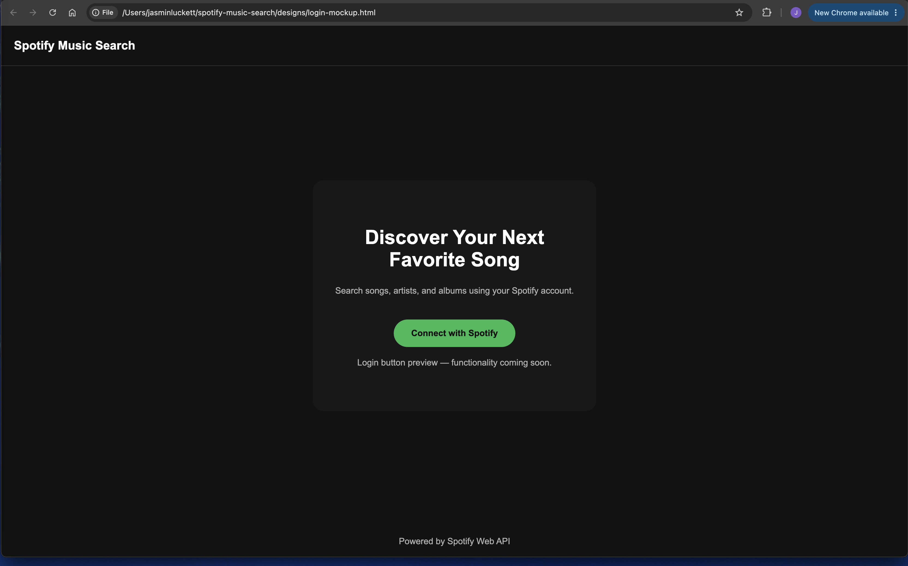
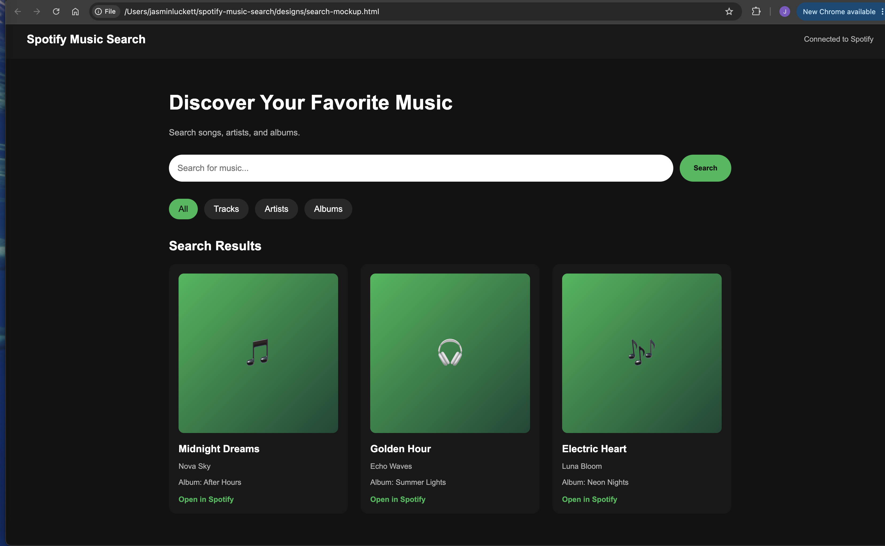

# Spotify Music Search

A full-stack music discovery application built with React, Node.js, Express, and the Spotify Web API.

This project is being developed using Agile practices, including GitHub issues, milestones, feature branches, and pull requests.

## Project Overview

Spotify Music Search will allow users to connect their Spotify accounts and search for songs, artists, and albums through a responsive web interface.

The application is being developed in four weekly phases.

## Current Project Status

**Week 1 — Project Setup and Agile Planning**

Completed:
- Created the GitHub repository
- Established an Agile development workflow
- Created an Express backend
- Configured environment variable support
- Added a backend health-check endpoint
- Deployed the backend to Render
- Created login and music search wireframes
- Built HTML/CSS interface mockups
- Captured screenshots of both designs

Planned:
- Spotify OAuth authentication
- Database-backed token persistence
- Spotify search API integration
- React frontend implementation

## Technology Stack

| Layer | Technology |
| --- | --- |
| Frontend (planned) | React, Vite, HTML, CSS |
| Backend | Node.js, Express |
| API | Spotify Web API (planned integration) |
| Authentication (planned) | Spotify OAuth Authorization Code Flow |
| Database (planned) | To be determined |
| Backend Hosting | Render |
| Version Control | Git and GitHub |

## Live Backend API

The Express backend is deployed on Render.

**API Base URL:**

https://spotify-music-search-api.onrender.com

**Health-Check Endpoint:**

https://spotify-music-search-api.onrender.com/api/health

Example successful response:

```json
{
  "success": true,
  "application": "Spotify Music Search",
  "message": "Backend API is running successfully"
}
```

The health-check endpoint has been tested successfully in Google Chrome.

## UI Design Preview

The following screenshots show the initial application designs. These are static mockups, not functional Spotify-connected pages.

### Login Screen



The login screen introduces the application and previews the Spotify connection button.

### Music Search Screen



The search screen previews:
- Music search input
- Search category filters
- Music result cards
- Album artwork placeholders
- Spotify result links

### Design Files

All wireframes, mockups, and planning documents are available in the [designs folder](designs/).

## Local Development Setup

### Prerequisites

- Node.js
- npm
- Git

### Clone the Repository

```bash
git clone https://github.com/LuckettJasmin-FS-4/spotify-music-search.git
cd spotify-music-search
```

### Install Backend Dependencies

```bash
cd backend
npm install
```

### Run the Backend

```bash
npm start
```

The backend uses port 3000 by default unless a PORT environment variable is provided.

### Test the API

Open:

http://localhost:3000/api/health

You should receive a JSON response confirming the API is running.

## Security

Environment variables are managed using dotenv.

Sensitive files such as `.env` and dependencies such as `node_modules` are excluded from version control.

Spotify client credentials and authentication tokens will not be committed to GitHub.

## Development Roadmap

### Week 1 — Setup and Planning
- GitHub repository and Agile planning
- Express backend setup
- Render deployment
- Initial UI designs
- Project documentation

### Week 2 — Spotify Authentication
- Spotify developer application
- OAuth Authorization Code Flow
- Backend authentication routes
- Database token persistence

### Week 3 — Backend Spotify Integration
- Custom Spotify API routes
- Search functionality
- Refresh expired access tokens
- Authentication status validation

### Week 4 — Frontend Integration
- React application interface
- Spotify login flow
- Protected search experience
- Display real Spotify results
- Final testing and deployment

## Development Workflow

This project uses an Agile-inspired GitHub workflow:

1. Create a GitHub issue
2. Assign the issue to a milestone
3. Create a feature branch
4. Implement and test changes
5. Open a pull request
6. Merge approved changes into main
7. Document completed work

## Repository

[Spotify Music Search on GitHub](https://github.com/LuckettJasmin-FS-4/spotify-music-search)

## Project Notes

This is an educational project under active development.

The current UI screens use fictional sample music data for design purposes. Real Spotify authentication, search results, and music information will be integrated in later development phases.
